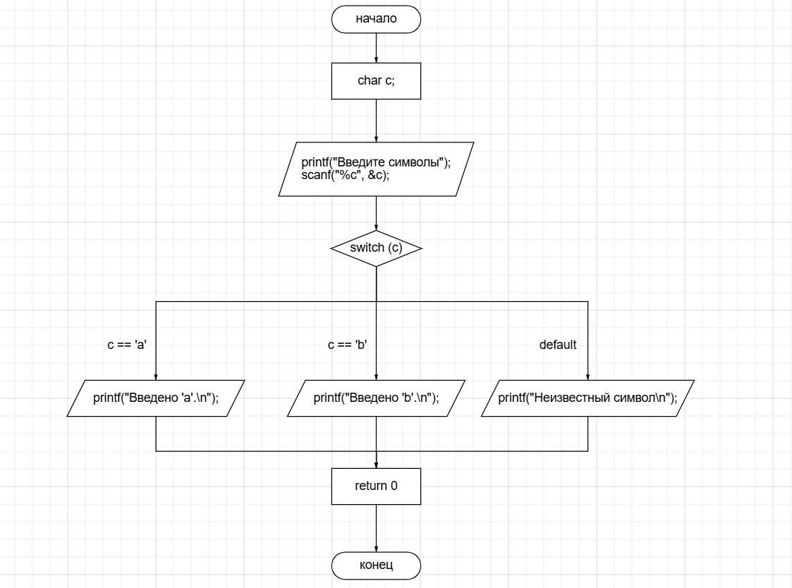
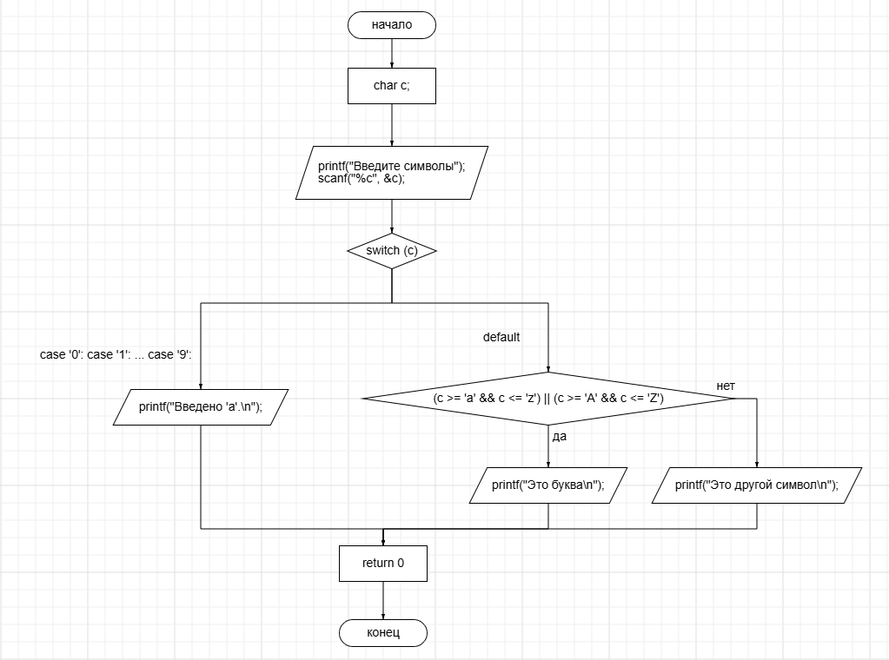
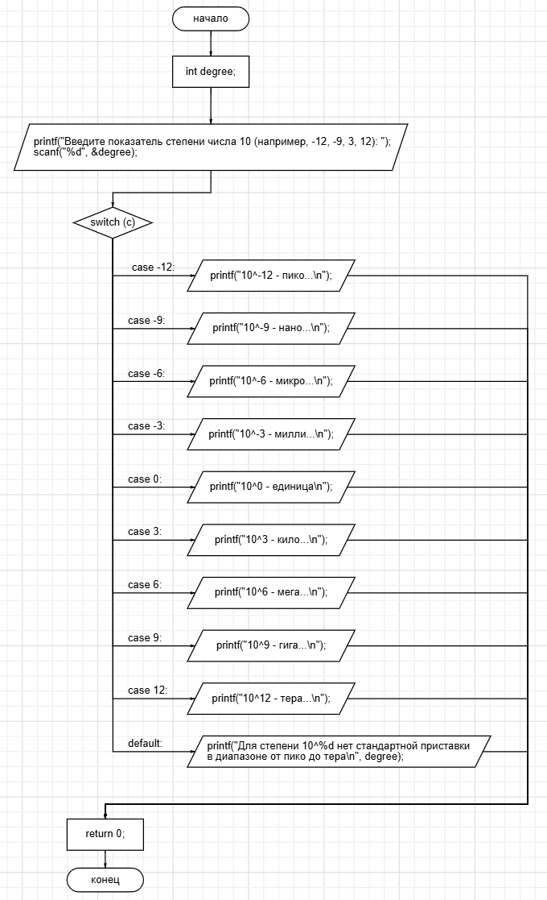

# Лабораторная работа 7

## Цель работы
Закрепление навыков использования ветвлений при написании программ.  

## Блок-схемы задания 1

## Блок-схема задания 3

## Результаты работы программы

## Информация о разработчике
Орлова Эльвира Эдуардовна
Группа: бИД-261
